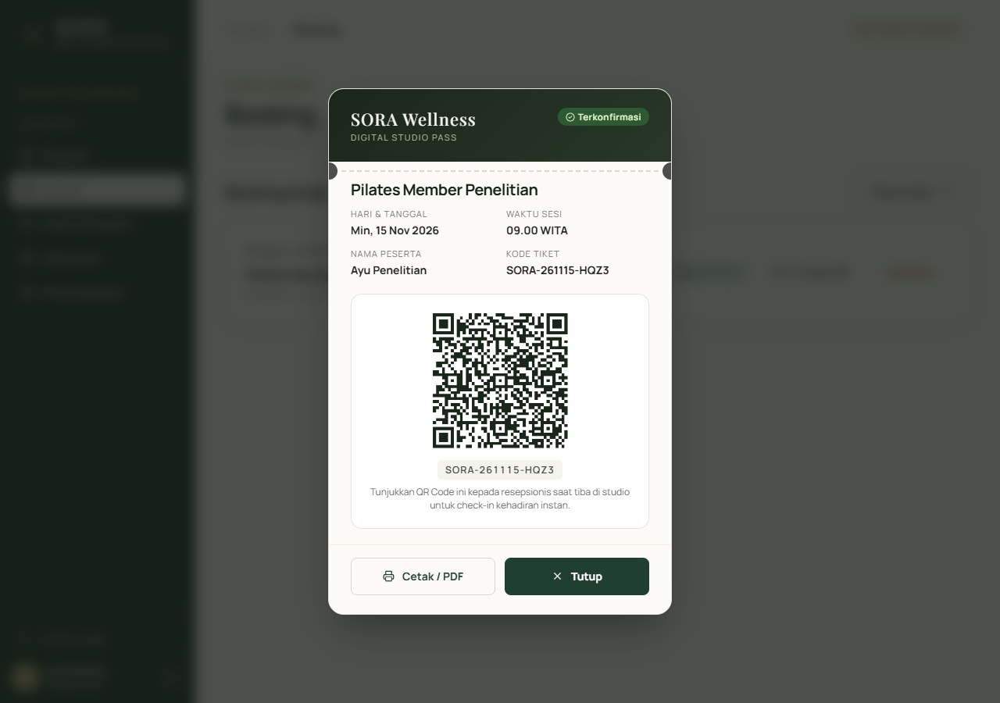
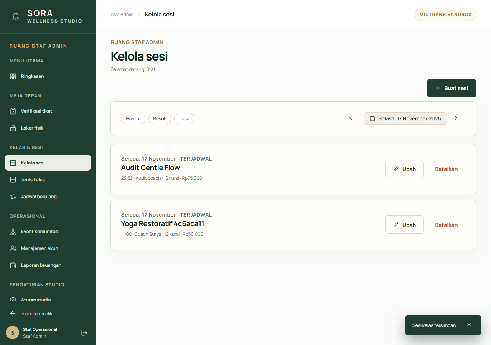
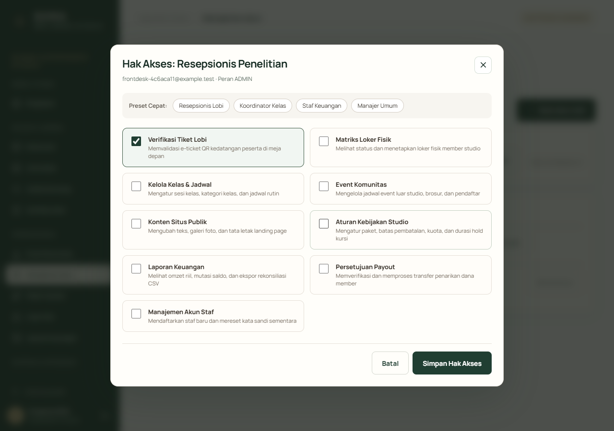
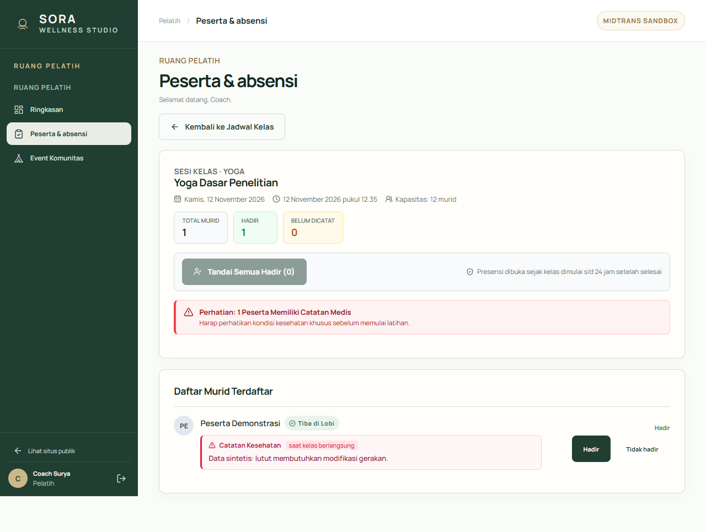
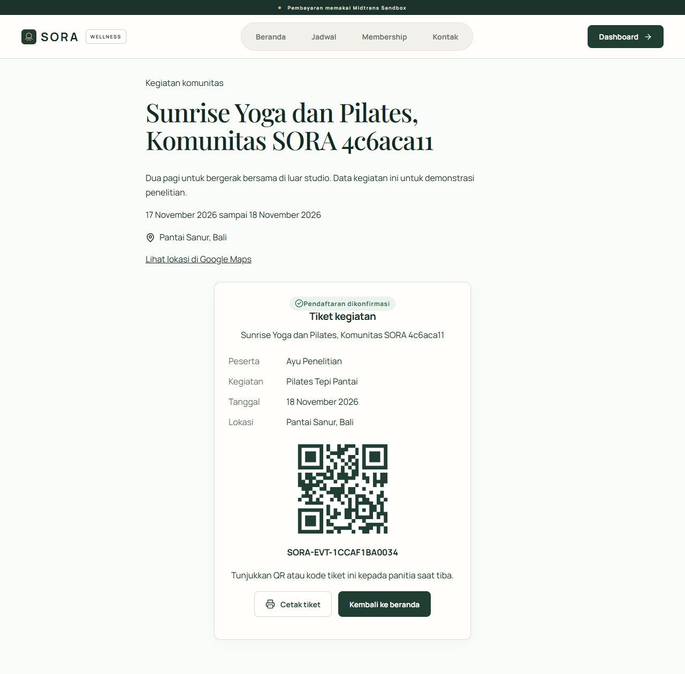

# Bahan pengujian dan screenshot jurnal

Seluruh hasil berikut berasal dari prototipe dengan data sintetis. Pengujian dilakukan pada 12 November 2026. PDF asli tidak diubah.

## Tabel pengujian utama

| ID | Skenario | Hasil yang diamati | Status |
|---|---|---|---|
| J-01 | Autentikasi dan kontrol akses modular | Registrasi/login/logout berhasil. Pencabutan izin mengubah menu. Sebanyak 110 pemeriksaan API sesuai izin, termasuk penolakan akses langsung | Lulus |
| J-02 | Perebutan kursi terakhir | 50 pelanggan terautentikasi mengirim booking HTTP dalam rentang dispatch 11,69 ms. Satu booking berhasil, 49 ditolak penuh, nol overbooking. Seluruh respons selesai sekitar 749,97 ms pada lingkungan lokal ini | Lulus |
| J-03 | Hak membership dan kuota | Paket lunas menghasilkan satu masa aktif. Jadwal member 30 hari, pelanggan tanpa paket 7 hari. Booking dengan kuota mengurangi tepat satu jatah dan menerbitkan tiket | Lulus |
| J-04 | Integrasi pembayaran dan pembatalan | Paket, kelas, dan event settled melalui Midtrans Sandbox. Dua replay webhook sah tidak menggandakan hak. Signature palsu ditolak. Pembatalan kelas mengkreditkan Rp75.000 sekali | Lulus |
| J-05 | Presensi dua tingkat dan privasi | Verifikasi lobi tidak mencatat presensi matras. Loker tampil di meja depan. Snapshot kesehatan hanya terlihat oleh coach sesi aktif, coach lain ditolak | Lulus |
| J-06 | Event komunitas luar studio | Admin membuat dua kegiatan dengan tanggal masing-masing. Pendaftaran gratis dan berbayar menghasilkan tiket yang dapat diverifikasi, sedangkan perubahan jadwal berpeserta ditolak | Lulus |

Angka konkurensi di atas adalah satu hasil percobaan lokal, bukan jaminan throughput produksi. Replay webhook dikirim melalui HTTP lokal setelah settlement Sandbox, bukan pengukuran pengiriman callback otomatis dari internet. Bukti mentah dan skrip tersedia di folder ini. Tes unit backend menggunakan Node.js test runner: 36 lulus. Tes feedback frontend: 6 lulus.

## Screenshot terpilih

### Gambar 1. Tiket kelas pelanggan setelah reservasi menggunakan kuota membership

### Gambar 2. Pengelolaan sesi studio oleh staf admin

### Gambar 3. Pengaturan sembilan izin granular oleh superadmin

### Gambar 4. Roster coach dengan status kedatangan lobi, presensi matras, dan catatan kesehatan sintetis berizin

### Gambar 5. Tiket kegiatan komunitas luar studio setelah pembayaran Sandbox

## Penyesuaian naskah agar sesuai implementasi

- Gunakan hasil aktual 36 unit test dengan Node.js test runner, bukan klaim Jest dan 27 kasus pada draf lama. Jangan mencampurkan jumlah unit test dengan 110 pemeriksaan akses atau 50 respons konkurensi.
- Loker ditetapkan admin kepada member aktif, bukan otomatis saat paket dibeli. Nomor loker tersebut ditampilkan ketika tiket diverifikasi.
- Signature memakai SHA-512 atas gabungan field pembayaran dan Server Key, sesuai kode MidtransClient. Istilah HMAC pada draf perlu disesuaikan.
- Cocokkan contoh endpoint dan nama izin dengan OpenAPI serta kode saat ini. Fixture terbaru memiliki 34 tabel publik, sehingga angka 16 tabel pada draf lama perlu disesuaikan dengan diagram yang benar-benar dibahas.

Tuliskan hanya fitur dan hasil yang dibuktikan. Tidak perlu memasukkan seluruh audit produksi, redesign, atau optimasi lanjutan ke naskah penelitian ini.
